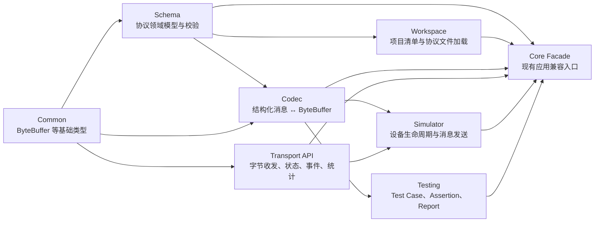

# IoT Protocol Studio Core 模块架构

> 架构版本：0.1  
> 更新日期：2026-08-28
> 适用范围：Portable C++ Core  
> 状态：模块边界和最小公共 API 已建立，完整 MVP 能力仍在开发中

相关文档：[功能清单与开发进度](<./IoT Protocol Studio 功能清单与开发进度.md>) · [Project Workspace v0.1](<./Project Workspace v0.1.md>) · [协议解析核心](<./协议解析核心.md>) · [固定长度 String 与 Bytes](<./固定长度 String 与 Bytes.md>) · [Length Field](<./Length Field.md>) · [固定长度 Array](<./固定长度 Array.md>) · [开发环境与构建](./开发环境与构建.md)

## 1. 目标

Core 采用一个跨平台源码树，不按 CPU 或操作系统复制目录。当前建立五个协议业务模块和一个 Workspace 模块：

```text
Schema
Workspace
Codec
Transport API
Simulator
Testing
```

模块通过 CMake target 和公共头文件共同形成边界。只创建子目录但仍链接为一个大库，不视为完成分层。

## 2. 依赖方向



关键约束：

1. Schema 不依赖 Codec、Transport、Simulator 或 Testing。
2. Workspace 依赖 Schema 加载项目引用的协议文件，只使用标准文件系统类型，不负责窗口或文件选择。
3. Codec 可以读取 Schema，但不负责连接、窗口或文件选择。
4. Transport 只处理字节和连接事件，不引用 Protocol、Message 或 Field。
5. Simulator 组合 Codec 与 Transport，不实现具体串口或 Socket。
6. Testing 当前复用 Codec 值类型；完整 Test Runner 后续才连接 Transport 执行步骤。
7. `iotps::core` 是给现有 CLI 和桌面 Host 使用的聚合 Facade，不允许反向成为各模块的依赖。

## 3. 目录结构

```text
core/
├── include/iotps/core/
│   ├── types.hpp
│   ├── result.hpp
│   ├── schema/schema.hpp
│   ├── workspace/workspace.hpp
│   ├── codec/codec.hpp
│   ├── transport/transport.hpp
│   ├── simulator/simulator.hpp
│   └── testing/testing.hpp
├── src/
│   ├── schema/schema.cpp
│   ├── workspace/workspace.cpp
│   ├── codec/codec.cpp
│   ├── transport/transport.cpp
│   ├── simulator/simulator.cpp
│   └── testing/testing.cpp
└── CMakeLists.txt
```

原有 `hex.hpp`、`checksum.hpp` 和相应实现继续保留兼容路径，但归入 Codec 构建目标。

## 4. CMake 模块目标

| CMake target | 公共别名 | 直接依赖 | 当前职责 |
|---|---|---|---|
| `iotps_core_common` | `iotps::common` | 无 | `ByteBuffer`、`Result`、`Status`、`Error` 等跨模块基础类型 |
| `iotps_schema` | `iotps::schema` | Common、Rapid YAML（私有） | Schema 领域模型、YAML/文件加载、版本和校验 |
| `iotps_workspace` | `iotps::workspace` | Schema、Rapid YAML（私有） | `project.yaml`、跨平台路径校验和项目协议加载 |
| `iotps_codec` | `iotps::codec` | Common、Schema | HEX/Checksum、Codec API、最小固定布局编解码 |
| `iotps_transport` | `iotps::transport` | Common | Transport 生命周期、事件、错误和统计 API |
| `iotps_simulator` | `iotps::simulator` | Codec、Transport | 单设备生命周期和编码后发送链路 |
| `iotps_testing` | `iotps::testing` | Codec | Test Case、Step、Assertion 和 Report 基础 |
| `iotps_core` | `iotps::core` | 上述全部模块 | 现有 Engine、CLI 和 Host 的兼容聚合入口 |

新代码应尽量链接最小模块。例如 Schema 单元测试只链接 `iotps::schema`，不得因为方便而链接整个 `iotps::core`。

## 5. 各模块当前公共能力

### 5.1 Schema

公共入口：`iotps/core/schema/schema.hpp`、`iotps/core/schema/loader.hpp`

当前已经提供：

- Schema 版本 `0.1`。
- Protocol 元数据和默认字节序。
- Message 名称、显示名和可选类型 ID。
- Field 名称、显示名、类型和可选字节序。
- Checksum 名称、算法和目标字段模型。
- 必填值、重复报文、重复类型 ID、重复字段和 Checksum 目标校验。
- 稳定 `SchemaErrorCode` 和领域路径。
- Rapid YAML `v0.16.0` 驱动的 YAML 字符串和文件加载。
- YAML 节点形状、必填属性和严格枚举值检查。
- 文件名、YAML 路径、字节偏移、行号和列号诊断。
- SmartSensor 示例、合法/非法向量和 `iotps schema validate <file>`。
- 单字段 `lengthOf` 模型、YAML 加载、无符号类型/目标/自引用/循环依赖校验。
- 固定 Array 的 Primitive `elementType`、固定 `count`、布局宽度和稳定诊断。
- Schema v0.1 兼容规则，详见 [Protocol Schema v0.1](<./Protocol Schema v0.1.md>)。

当前没有提供：

- Schema 文件自动迁移和无损写回。
- 完整 Field 属性和动态结构校验。

### 5.2 Workspace

公共入口：`iotps/core/workspace/workspace.hpp`

当前已经提供：

- Project Schema 版本 `0.1` 和项目元数据模型。
- `project.yaml` 文件加载及 YAML 文件、路径、偏移和行列诊断。
- 使用 `/` 的跨平台协议相对路径、规范化、重复和目录逃逸校验。
- 加载 `protocols/` 下引用的 Protocol Schema，并保留下层 Schema 诊断。
- `create_protocol()` 按相对路径创建嵌套目录和最小 Protocol Schema，安全写回 `project.yaml` 并回读校验。
- 创建时拒绝目录逃逸、非便携路径、重复引用和覆盖已有文件；写回失败时恢复原清单。
- `iotps project validate <directory>` CLI 验证入口。

Windows Host 已通过系统目录选择器和 WebView Bridge 复用以上 Core API，实现项目打开/关闭、真实嵌套 Explorer、Protocol 创建以及 YAML 校验后原子保存。Core 当前没有提供完整 Project 创建、Protocol 重命名/删除、最近项目、外部文件监听或未保存修改处理。完整契约见 [Project Workspace v0.1](<./Project Workspace v0.1.md>)。

### 5.3 Codec

公共入口：`iotps/core/codec/codec.hpp`

公共模型包括 `PrimitiveValue`、`ArrayValue`、`ScalarValue`、`StructuredMessage`、`DecodedMessage`、字段/数组元素字节范围和稳定错误码。`MessageCodec` 是可替换编解码接口。

`FixedLayoutCodec` 已对固定长度 Primitive、UTF-8 string、bytes、最小 Length Field 和固定 Primitive Array 提供对称 Encode/Decode：

```text
MessageDefinition + StructuredMessage / ByteBuffer
  → 校验字段集合、ScalarValue 类型和表示范围
  → 共享布局计划解析 Field length / offset
  → 按固定位置 Encode / Decode，gap 编码为 0x00
  → Field endian 覆盖
  → bool / 8-64 位整数 / float32 / float64
  → UTF-8 string / ByteBuffer
  → 固定 count Primitive Array / ArrayValue
  → lengthOf Decode 校验 / Encode 自动回填
  → ByteBuffer / StructuredMessage + FieldRange / element ranges
```

Encode 对名称不匹配、缺失/重复/额外字段、ScalarValue 类型不匹配、数组数量不一致、数值或长度越界、非法 UTF-8 和非法布局返回稳定路径、偏移和原因；Decode 对非法 bool、输入不足、非法 UTF-8/NUL padding、Length 声明不一致、非法数组布局和尾随数据提供同类诊断。详细契约见 [Primitive Encode](<./Primitive Encode.md>)、[Primitive Decode](<./Primitive Decode.md>)、[固定 Field 布局](<./固定 Field 布局.md>)、[固定长度 String 与 Bytes](<./固定长度 String 与 Bytes.md>)、[Length Field](<./Length Field.md>) 和 [固定长度 Array](<./固定长度 Array.md>)。

协议级入口 `decode_protocol_message()`、`decode_protocol_hex()`、`encode_protocol_message()` 和 `encode_protocol_hex()` 负责按 Message 名称查找 Schema、转换 HEX、应用 Protocol 默认字节序并调用 `FixedLayoutCodec`。稳定的 `ProtocolCodecErrorCode` 区分 Message 不存在、HEX 解析失败、Decode 失败和 Encode 失败；下层错误码、路径和偏移继续保留。详细契约见 [协议解析核心](<./协议解析核心.md>)。

尚未实现的部分包括：动态长度 string/bytes、连续 Length Range、动态 Array、BCD、timestamp、Enum、BitField、Struct、Condition 和 Checksum。

### 5.4 Transport API

公共入口：`iotps/core/transport/transport.hpp`

Transport 与 Schema/Codec 完全解耦，统一暴露：

- `open()`、`close()`、`send()` 生命周期。
- `closed/opening/open/closing/faulted` 状态。
- 稳定 Transport 错误码。
- `data_received` 等事件入口。
- 发送、接收、消息和错误统计。

接收数据通过事件推送，避免要求所有 Transport 使用同一种阻塞读取方式。当前尚无 Serial、TCP、UDP 或可复用 Loopback 实现，也没有取消对象和连接配置序列化。

### 5.5 Simulator

公共入口：`iotps/core/simulator/simulator.hpp`

`DeviceSimulator` 接收 `MessageCodec` 和 `Transport` 依赖，当前支持：

- Device、Protocol 和 Connection 标识配置。
- `offline/starting/online/stopping/error` 生命周期。
- 启动和停止 Transport。
- 通过 Codec 编码结构化消息，允许调用方传入 Protocol 默认字节序，再通过 Transport 发送。
- 将 Codec/Transport 错误转换为稳定 Simulator 错误。

当前尚无配置文件、定时任务、WAIT、IF/ELSE、多设备和 GUI。

### 5.6 Testing

公共入口：`iotps/core/testing/testing.hpp`

当前已经提供：

- Test Case、Test Step、Step Result 和 Test Report 模型。
- Setup、Connect、Send、Receive、Decode、Assertion、Cleanup 步骤类型。
- `equals` 和 `notEquals` 断言求值。
- Expected、Actual 和字段路径结果。
- Passed、Failed、Skipped 报告汇总。

步骤类型目前只是领域模型，尚没有 Connect/Send/Receive/Decode 执行器、超时、取消、报告导出或 GUI。

## 6. 错误和本地化边界

Core 返回稳定错误枚举、机器可读字符串和结构化路径，不返回中文或英文用户文案。React Web UI 根据错误码完成本地化。

所有只返回一个成功值或一个错误的 Core API 统一使用：

```cpp
Result<Value, ErrorType>
Status<ErrorType> // 等价于 Result<std::monostate, ErrorType>
Error<ModuleErrorCode>
```

统一错误上下文包含：

```text
code    模块强类型错误码
path    Message/Field/配置等领域路径
offset  可选字节偏移或源码偏移
detail  非本地化技术细节或下层原因码
```

调用方统一通过 `has_value()`、`value()`、`error()`、`value_if()` 和 `error_if()` 读取结果。Schema 校验需要一次返回多个诊断，因此保留 `SchemaValidation` 容器，但其中每个 `SchemaDiagnostic` 都是统一的 `Error<SchemaErrorCode>`。

模块错误保持各自命名空间：

```text
schema::SchemaErrorCode
workspace::WorkspaceErrorCode
codec::CodecErrorCode
transport::TransportErrorCode
simulator::SimulatorErrorCode
```

模块仍保留各自的强类型错误码，不建立覆盖所有模块的巨型错误枚举。这样既统一调用方式和错误上下文，也不会让 Schema、Codec、Transport、Simulator 互相依赖错误定义。

## 7. 测试边界

每个测试只链接它验证的公共模块：

| 测试 | 链接模块 | 验证行为 |
|---|---|---|
| `iotps_result_unit_test` | Common | 成功值、错误值、指针访问和 `Status` |
| `iotps_schema_unit_test` | Schema | 合法 Schema、重复名称、字段路径和错误码 |
| `iotps_schema_loader_unit_test` | Schema | YAML/文件加载、节点类型、枚举、领域校验和源码位置 |
| `iotps_workspace_unit_test` | Workspace、Schema | `project.yaml`、跨平台路径、协议加载、嵌套 Protocol 创建/回滚和稳定诊断 |
| `iotps_codec_unit_test` | Codec | 固定 Primitive/string/bytes/Array Encode/Decode、字节序、布局、padding、范围和错误诊断 |
| `iotps_primitive_decode_integration_test` | Codec、Schema | Schema YAML → 非连续 HEX → 多类型 Decode → expected golden vector |
| `iotps_primitive_encode_integration_test` | Codec、Schema | Schema YAML → Decode → 固定布局 Encode → golden HEX → Decode round-trip |
| `iotps_fixed_text_integration_test` | Codec、Schema | Schema YAML → UTF-8 string/bytes Decode → expected → Encode round-trip |
| `iotps_length_field_integration_test` | Codec、Schema | Schema YAML → Length Decode 校验 → 自动 Encode → golden round-trip |
| `iotps_fixed_array_integration_test` | Codec、Schema | Schema YAML → 固定 Array Decode/Encode → 元素范围 → Length 组合 → golden round-trip |
| `iotps_protocol_codec_integration_test` | Codec、Schema | Protocol Schema + Message 名称 + HEX/ByteBuffer → Decode/Encode → golden round-trip 和错误映射 |
| `iotps_simulator_integration_test` | Simulator | Codec → Simulator → Transport 发送链路和生命周期 |
| `iotps_testing_unit_test` | Testing | 断言求值和测试报告汇总 |

Simulator 集成测试只替换 Transport，因为 Transport 是操作系统和网络边界；Schema 和 Codec 使用真实实现。

## 8. 下一步

固定布局 Codec、协议级 HEX/Binary 解析入口、Workspace 加载以及 Protocol 源码编辑安全保存已经完成。下一入口进入 Protocol Designer 的只读可视化字段树：

```text
ProtocolSchema 领域模型
  → Host Bridge 输出 Message / Field 层级
  → Web UI 显示只读可视化字段树
  → Code / Visual 视图共享当前 Protocol
```

下一入口只展示现有 Core 已解析的 Message / Field 结构，不在 TypeScript 中解析 YAML，也不同时实现可视化修改、双向同步、拖放、语法高亮、自动补全、Protocol 重命名/删除、真实 TCP/Serial、Simulator 行为 DSL 或完整 Test Runner。自动 Message 匹配需要先定义 wire 匹配规则；Count/Length 驱动 Array 与 Struct/Condition 保留在后续动态 Schema 阶段。
