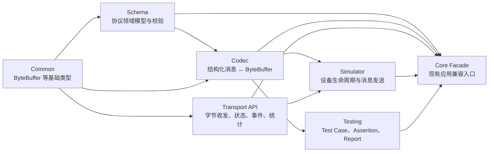

# IoT Protocol Studio Core 模块架构

> 架构版本：0.1  
> 更新日期：2026-08-22  
> 适用范围：Portable C++ Core  
> 状态：模块边界和最小公共 API 已建立，完整 MVP 能力仍在开发中

相关文档：[功能清单与开发进度](<./IoT Protocol Studio 功能清单与开发进度.md>) · [开发环境与构建](./开发环境与构建.md)

## 1. 目标

Core 采用一个跨平台源码树，不按 CPU 或操作系统复制目录。当前建立五个业务模块：

```text
Schema
Codec
Transport API
Simulator
Testing
```

模块通过 CMake target 和公共头文件共同形成边界。只创建子目录但仍链接为一个大库，不视为完成分层。

## 2. 依赖方向



关键约束：

1. Schema 不依赖 Codec、Transport、Simulator 或 Testing。
2. Codec 可以读取 Schema，但不负责连接、窗口或文件选择。
3. Transport 只处理字节和连接事件，不引用 Protocol、Message 或 Field。
4. Simulator 组合 Codec 与 Transport，不实现具体串口或 Socket。
5. Testing 当前复用 Codec 值类型；完整 Test Runner 后续才连接 Transport 执行步骤。
6. `iotps::core` 是给现有 CLI 和桌面 Host 使用的聚合 Facade，不允许反向成为各模块的依赖。

## 3. 目录结构

```text
core/
├── include/iotps/core/
│   ├── types.hpp
│   ├── result.hpp
│   ├── schema/schema.hpp
│   ├── codec/codec.hpp
│   ├── transport/transport.hpp
│   ├── simulator/simulator.hpp
│   └── testing/testing.hpp
├── src/
│   ├── schema/schema.cpp
│   ├── codec/codec.cpp
│   ├── transport/transport.cpp
│   ├── simulator/simulator.cpp
│   └── testing/testing.cpp
└── CMakeLists.txt
```

原有 `hex.hpp`、`checksum.hpp` 和相应实现继续保留兼容路径，但归入 Codec 构建目标。

## 4. CMake 模块目标

| CMake target | 公共别名 | 直接依赖 | 当前职责 |
|---|---|---|---|
| `iotps_core_common` | `iotps::common` | 无 | `ByteBuffer`、`Result`、`Status`、`Error` 等跨模块基础类型 |
| `iotps_schema` | `iotps::schema` | Common、Rapid YAML（私有） | Schema 领域模型、YAML/文件加载、版本和校验 |
| `iotps_codec` | `iotps::codec` | Common、Schema | HEX/Checksum、Codec API、最小固定布局编解码 |
| `iotps_transport` | `iotps::transport` | Common | Transport 生命周期、事件、错误和统计 API |
| `iotps_simulator` | `iotps::simulator` | Codec、Transport | 单设备生命周期和编码后发送链路 |
| `iotps_testing` | `iotps::testing` | Codec | Test Case、Step、Assertion 和 Report 基础 |
| `iotps_core` | `iotps::core` | 上述全部模块 | 现有 Engine、CLI 和 Host 的兼容聚合入口 |

新代码应尽量链接最小模块。例如 Schema 单元测试只链接 `iotps::schema`，不得因为方便而链接整个 `iotps::core`。

## 5. 各模块当前公共能力

### 5.1 Schema

公共入口：`iotps/core/schema/schema.hpp`、`iotps/core/schema/loader.hpp`

当前已经提供：

- Schema 版本 `0.1`。
- Protocol 元数据和默认字节序。
- Message 名称、显示名和可选类型 ID。
- Field 名称、显示名、类型和可选字节序。
- Checksum 名称、算法和目标字段模型。
- 必填值、重复报文、重复类型 ID、重复字段和 Checksum 目标校验。
- 稳定 `SchemaErrorCode` 和领域路径。
- Rapid YAML `v0.16.0` 驱动的 YAML 字符串和文件加载。
- YAML 节点形状、必填属性和严格枚举值检查。
- 文件名、YAML 路径、字节偏移、行号和列号诊断。
- SmartSensor 示例、合法/非法向量和 `iotps schema validate <file>`。
- Schema v0.1 兼容规则，详见 [Protocol Schema v0.1](<./Protocol Schema v0.1.md>)。

当前没有提供：

- Schema 文件自动迁移和无损写回。
- 完整 Field 属性和动态结构校验。

### 5.2 Codec

公共入口：`iotps/core/codec/codec.hpp`

公共模型包括 `ScalarValue`、`StructuredMessage`、`DecodedMessage`、字段字节范围和稳定错误码。`MessageCodec` 是可替换编解码接口。

当前 `FixedLayoutCodec` 只实现一个经过测试的 `uint8` 固定顺序切片：

```text
MessageDefinition + StructuredMessage
  → Encode
  → ByteBuffer
  → Decode
  → StructuredMessage + FieldRange
```

其他整数、浮点、字节序、数组、结构体、Length 和 Checksum 尚未实现。

### 5.3 Transport API

公共入口：`iotps/core/transport/transport.hpp`

Transport 与 Schema/Codec 完全解耦，统一暴露：

- `open()`、`close()`、`send()` 生命周期。
- `closed/opening/open/closing/faulted` 状态。
- 稳定 Transport 错误码。
- `data_received` 等事件入口。
- 发送、接收、消息和错误统计。

接收数据通过事件推送，避免要求所有 Transport 使用同一种阻塞读取方式。当前尚无 Serial、TCP、UDP 或可复用 Loopback 实现，也没有取消对象和连接配置序列化。

### 5.4 Simulator

公共入口：`iotps/core/simulator/simulator.hpp`

`DeviceSimulator` 接收 `MessageCodec` 和 `Transport` 依赖，当前支持：

- Device、Protocol 和 Connection 标识配置。
- `offline/starting/online/stopping/error` 生命周期。
- 启动和停止 Transport。
- 通过 Codec 编码结构化消息，再通过 Transport 发送。
- 将 Codec/Transport 错误转换为稳定 Simulator 错误。

当前尚无配置文件、定时任务、WAIT、IF/ELSE、多设备和 GUI。

### 5.5 Testing

公共入口：`iotps/core/testing/testing.hpp`

当前已经提供：

- Test Case、Test Step、Step Result 和 Test Report 模型。
- Setup、Connect、Send、Receive、Decode、Assertion、Cleanup 步骤类型。
- `equals` 和 `notEquals` 断言求值。
- Expected、Actual 和字段路径结果。
- Passed、Failed、Skipped 报告汇总。

步骤类型目前只是领域模型，尚没有 Connect/Send/Receive/Decode 执行器、超时、取消、报告导出或 GUI。

## 6. 错误和本地化边界

Core 返回稳定错误枚举、机器可读字符串和结构化路径，不返回中文或英文用户文案。React Web UI 根据错误码完成本地化。

所有只返回一个成功值或一个错误的 Core API 统一使用：

```cpp
Result<Value, ErrorType>
Status<ErrorType> // 等价于 Result<std::monostate, ErrorType>
Error<ModuleErrorCode>
```

统一错误上下文包含：

```text
code    模块强类型错误码
path    Message/Field/配置等领域路径
offset  可选字节偏移或源码偏移
detail  非本地化技术细节或下层原因码
```

调用方统一通过 `has_value()`、`value()`、`error()`、`value_if()` 和 `error_if()` 读取结果。Schema 校验需要一次返回多个诊断，因此保留 `SchemaValidation` 容器，但其中每个 `SchemaDiagnostic` 都是统一的 `Error<SchemaErrorCode>`。

模块错误保持各自命名空间：

```text
schema::SchemaErrorCode
codec::CodecErrorCode
transport::TransportErrorCode
simulator::SimulatorErrorCode
```

模块仍保留各自的强类型错误码，不建立覆盖所有模块的巨型错误枚举。这样既统一调用方式和错误上下文，也不会让 Schema、Codec、Transport、Simulator 互相依赖错误定义。

## 7. 测试边界

每个测试只链接它验证的公共模块：

| 测试 | 链接模块 | 验证行为 |
|---|---|---|
| `iotps_result_unit_test` | Common | 成功值、错误值、指针访问和 `Status` |
| `iotps_schema_unit_test` | Schema | 合法 Schema、重复名称、字段路径和错误码 |
| `iotps_schema_loader_unit_test` | Schema | YAML/文件加载、节点类型、枚举、领域校验和源码位置 |
| `iotps_codec_unit_test` | Codec | `uint8` Encode/Decode round-trip、字节范围和越界错误 |
| `iotps_simulator_integration_test` | Simulator | Codec → Simulator → Transport 发送链路和生命周期 |
| `iotps_testing_unit_test` | Testing | 断言求值和测试报告汇总 |

Simulator 集成测试只替换 Transport，因为 Transport 是操作系统和网络边界；Schema 和 Codec 使用真实实现。

## 8. 下一步

`M02-F01 Protocol Schema v0.1` 的 YAML 加载链路已经完成。当前产品主线进入 `M03-F02 Schema Decode` 的 Primitive Decode：

```text
ProtocolSchema + MessageDefinition
  → 选择 Message
  → 按字段顺序读取基础整数和浮点类型
  → 应用 Big/Little Endian
  → 返回字段值与 byte offset/length span
  → 建立多类型 Decode 测试向量
```

在 Primitive Decode/Encode round-trip 稳定之前，不扩展真实 TCP/Serial、Simulator 行为 DSL 或完整 Test Runner。
